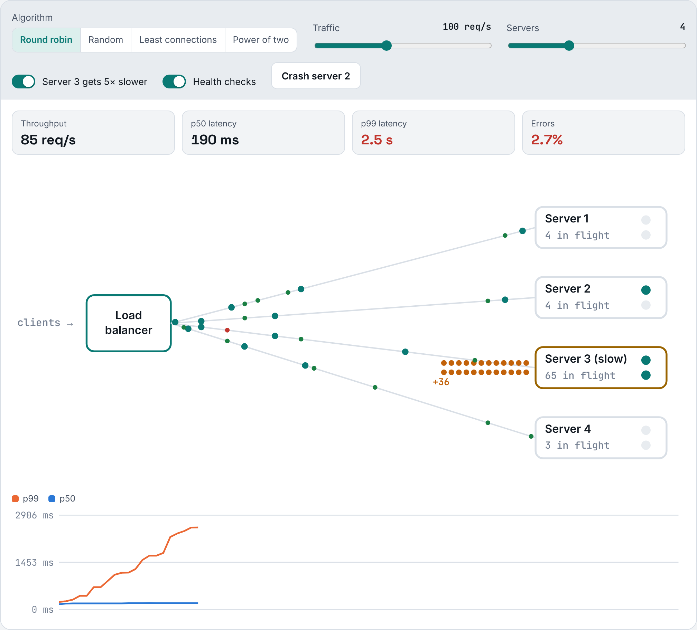
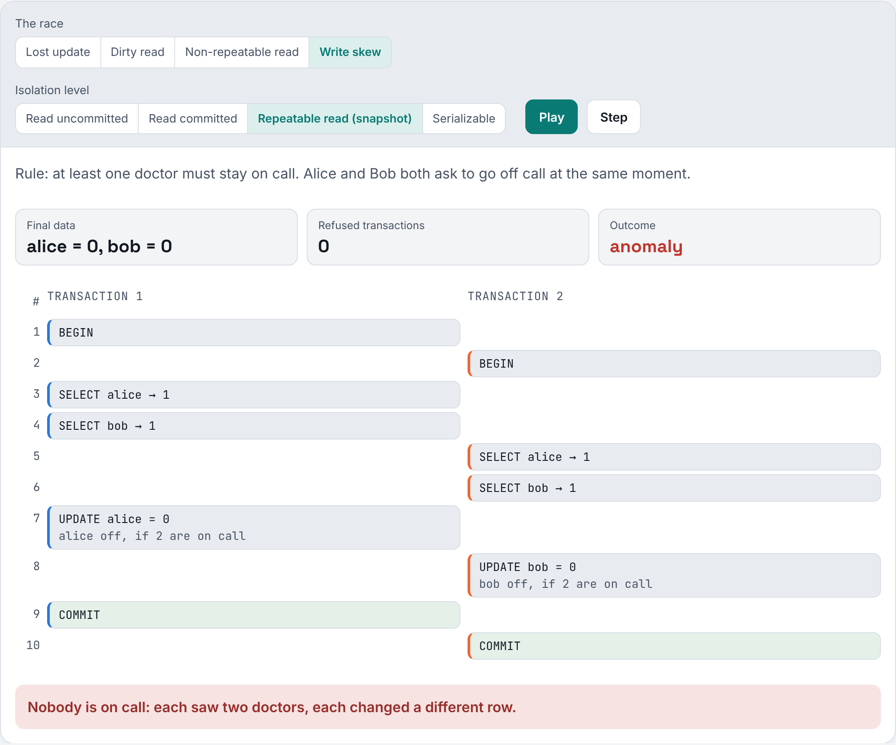
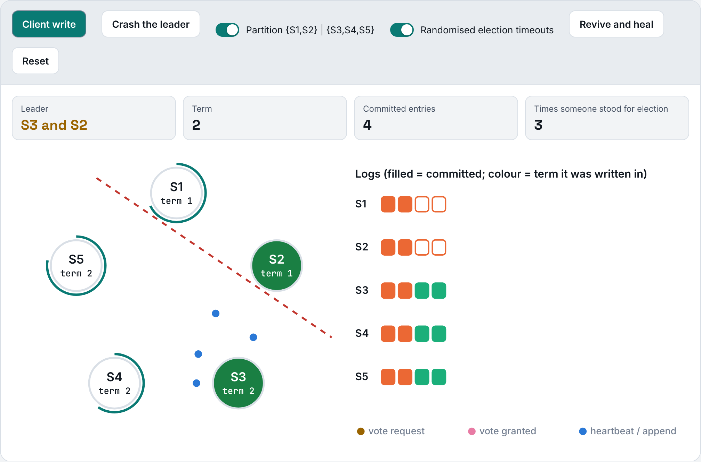

# App Anatomy

**How apps are actually built, taught through simulations you can poke.**

Start with a single request. End with load balancers, queues, databases, LLM agents and MCP servers. Every chapter follows the same rhythm: read a little, **predict** what will happen, **run** the simulation, and take the **real code** home in Python, TypeScript, SQL or config.



## The course

| Level | Chapters |
|---|---|
| **0 · Foundations** | What happens when you press Enter (DNS → TCP → TLS → HTTP waterfall) · Where the HTML gets made (CSR, SSR, static, streaming) · Talking to a server (REST, BFF, GraphQL, gRPC) |
| **1 · A normal app** | Anatomy of a CRUD app (layers, N+1) · Why some queries are instant (B-trees, composite indexes) · Who are you? (sessions vs real WebCrypto JWTs, OAuth + PKCE) |
| **2 · System design** | Caching and the stampede · Load balancers · Queues and workers (retry storms, DLQs) · Rate limiting (fixed, sliding, token bucket) |
| **3 · Distributed systems** | Sharding and consistent hashing (keys that move, virtual nodes) · Replicas and quorums (N/R/W, stale reads, partitions) · Consensus (a live five-server Raft) · Tail latency and fan-out (p99, hedged requests) · Retries, backoff and circuit breakers (metastable failure) · Idempotency (exactly-once effects, the outbox) · Back-of-the-envelope design (capacity estimates, a URL shortener walkthrough) |
| **4 · Running it for real** | Transactions and isolation levels (lost updates, dirty reads, write skew in a tiny MVCC database) · Deploys that can't take you down (all-at-once, rolling, blue/green, canary analysis, expand-contract migrations) · Changing the schema while it's live (six plans for a column rename under traffic, the lock queue behind an ALTER, lock_timeout) · Finding what's slow (a trace waterfall: N+1, locks, slow dependencies, retries, serial calls) · Autoscaling through a spike (why CPU scaling climbs in steps, headroom, pre-warming, cold starts) |
| **5 · Low-level design** | State machines (guards, event replay) · Patterns that earn their keep (adapter, strategy, observer) |
| **6 · Real-time and offline** | Polling, SSE or WebSockets? · Offline edits that merge (last-write-wins vs an OR-Set CRDT) |
| **7 · AI apps** | How an LLM writes (tokens, temperature, top-p, context budget) · RAG in the browser · The agent loop · MCP (a working JSON-RPC server in the page) · Streaming generative UI |
| **8 · Every kind of app** | The app atlas: 13 architectures from a static blog to ride-hailing, payments, multiplayer games and AI agents |





Each chapter includes at least one **dilemma**: a real trade-off with no free answer, and what teams usually choose.

## Run it

No build step and no dependencies. It's plain HTML, CSS and ES modules.

```bash
npm run dev        # http://localhost:4173 (clean URLs like production)
npm test           # opens every chapter in Chromium, pokes every control, fails on errors or overflow
```

`npm test` needs Playwright with Chromium installed. Deploy by pushing to Vercel or any static host (`vercel.json` enables clean URLs).

## How it's built

```
index.html, learn.html   home (course map) and the chapter shell (/learn?c=<id>)
lib/core.js              DOM builder, seeded RNG, percentiles, animation loop, progress
lib/widgets.js           sliders, predict cards, steppers, code tabs, live charts, dilemmas
lib/flow.js              canvas layer for traffic simulations (boxes, wires, moving dots)
lib/catalog.js           the curriculum
chapters/<id>.js         one module per chapter: export default (root) => { ... }
test/smoke.mjs           browser test for every page
```

To add a chapter, add an entry to `lib/catalog.js` and a module in `chapters/` that builds its page from the widgets.

The simulations are simple models built to show behaviour (queues growing, p99 exploding, caches warming), not benchmarks. Where a number comes from the real world, such as latency tables or protocol messages, it's labelled.

## Companion project

[genui-stream](https://github.com/srivtx/genui-stream) is a production-style implementation of chapter 6.5: an LLM that streams text and live UI components.
